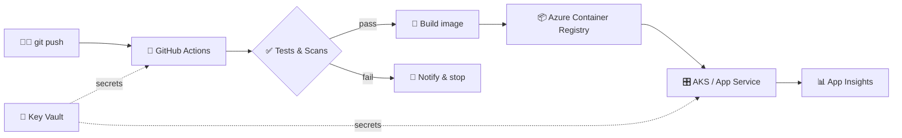

<!-- ============================ HEADER ============================ -->
<p align="center">
  
</p>

<p align="center">
  <a href="https://athulsreee.com">
    
  </a>
</p>

<p align="center">
  <a href="https://athulsreee.com"></a>
  <a href="https://www.linkedin.com/in/athultsreekumar/"></a>
  <a href="mailto:athult2000@gmail.com"></a>
  
</p>

---

## 🧑‍💻 `whoami`

```yaml
name:      Athul Sreekumar
role:      DevOps Engineer · Fullstack Developer
cloud:     Microsoft Azure (networking, security, monitoring, IaC)
currently: orchestrating complete Azure infrastructures & CI/CD for production mobile apps
website:   https://athulsreee.com
motto:     "Automate everything. Scale anything. Secure everywhere."
off_duty:  [📚 books, ⚽ football, 🚀 tech]
reading:   ["Animal Farm", "Metamorphosis"]
```

> 👇 **Click any section below to expand it.**

<details>
<summary><b>☁️ What I do — DevOps & Cloud</b></summary>
<br/>

- 🏗️ Provision and run **entire Azure environments** with Terraform (VNets, AKS, ACR, Key Vault, App Insights)
- 🤖 Design **CI/CD pipelines** in GitHub Actions & Azure DevOps — build, test, scan, deploy
- 📱 Fully automated **iOS & Android releases** straight from pipelines
- 🔐 End-to-end **secret management** across infra, pipelines and containers
- 📊 Observability with Application Insights, alerts and dashboards

</details>

<details>
<summary><b>⚛️ What I do — Fullstack</b></summary>
<br/>

- Web apps with **React** and **Next.js**
- APIs and **microservices** with **Node.js** and **Python**
- Data with **PostgreSQL**
- Mobile with **React Native**

</details>

<details>
<summary><b>🏆 Highlights</b></summary>
<br/>

| | Achievement |
|---|---|
| 💼 | **Azure Cloud Professional** |
| ⚡ | Built & deployed **scalable microservices** powering production mobile apps |
| 🔐 | Designed **secure, automated secret management** across infra, CI/CD and containers |
| 📱 | Automated **iOS & Android deployments** via GitHub Actions |
| 🌍 | Open to **collaborations** on cloud-native projects |

</details>

<details>
<summary><b>🛤️ My deploy pipeline, as a diagram</b></summary>
<br/>



</details>

---

## 🔧 Tech Stack

<p align="center"><b>Cloud & DevOps</b><br/><br/>
  
</p>

<p align="center"><b>Fullstack</b><br/><br/>
  
</p>

---

## 📊 GitHub Activity

<p align="center">
  
  
</p>

<p align="center">
  
</p>

<p align="center">
  
</p>

<p align="center">
  <picture>
    <source media="(prefers-color-scheme: dark)" srcset="https://raw.githubusercontent.com/athulsreekumar/athulsreekumar/output/github-snake-dark.svg" />
    
  </picture>
</p>

---

## 🗺️ Roadmap — what's next

- [x] Azure Cloud Professional
- [x] Automated mobile (iOS/Android) release pipelines
- [x] Secret management across infra, CI/CD & containers
- [ ] 🎯 Azure Solutions Architect Expert (AZ-305)
- [ ] 🎯 Certified Kubernetes Administrator (CKA)
- [ ] 🧪 GitOps with Argo CD / Flux
- [ ] 📈 Platform engineering & internal developer portals
- [ ] 🌱 More open-source contributions

---

## 🤝 Let's work together

<details>
<summary><b>💬 I'm open to…</b></summary>
<br/>

- Cloud infrastructure & DevOps consulting
- CI/CD and release automation
- Fullstack / cloud-native side projects
- Chatting about books and football ⚽

👉 Best place to start: **[athulsreee.com](https://athulsreee.com)** or **[email me](mailto:athult2000@gmail.com)**.

</details>

<p align="center">
  
</p>
