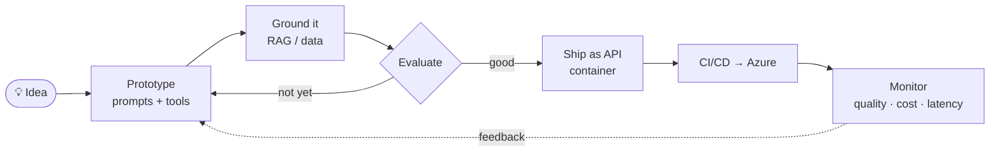

<p align="center">
  
</p>

<p align="center">
  <a href="https://athulsreee.com">
    
  </a>
</p>

<p align="center">
  <a href="https://athulsreee.com"></a>
  <a href="https://www.linkedin.com/in/athultsreekumar/"></a>
  <a href="mailto:athult2000@gmail.com"></a>
  
</p>

<br/>

<h3 align="center">I turn ideas into intelligent products — and the cloud platforms that keep them running.</h3>

<p align="center">
Most people do either the AI or the infrastructure. I do both:<br/>
I design the models' workflows, wire them into real products, and build the pipelines,<br/>
security and cloud underneath so they hold up in production.
</p>

<br/>

## ◆ What I build

<table>
<tr>
<td width="33%" valign="top">

### 🧠 AI Systems
LLM-powered applications, autonomous agents and retrieval pipelines that work on real data — not demos.

</td>
<td width="33%" valign="top">

### ☁️ Cloud Platforms
Complete Azure environments as code: networking, containers, secrets, monitoring — secure by default.

</td>
<td width="33%" valign="top">

### ⚡ Products
Fullstack web and mobile apps, shipped through pipelines that test, build and release themselves.

</td>
</tr>
</table>

<br/>

## ◆ AI — what I work on

<details open>
<summary><b>Explore</b></summary>
<br/>

| Area | What that means |
|---|---|
| **LLM applications** | Production apps built on large language models — prompt design, structured outputs, tool/function calling, streaming UX |
| **AI agents** | Multi-step agents that plan, call tools and APIs, and take actions inside real workflows |
| **RAG & knowledge** | Embeddings, vector search and retrieval pipelines that ground answers in private data |
| **AI automation** | Replacing manual, repetitive work with AI-driven pipelines and integrations |
| **Evaluation & guardrails** | Testing model output, catching failures, keeping cost and latency in check |
| **LLMOps** | Deploying, versioning, monitoring and securing AI services in the cloud |

</details>

<details>
<summary><b>How an AI feature goes from idea to production</b></summary>
<br/>



</details>

<br/>

## ◆ Cloud & DevOps

<details>
<summary><b>Explore</b></summary>
<br/>

- Full **Azure infrastructure** in Terraform — VNets, containers, registries, Key Vault, App Insights
- **CI/CD** with GitHub Actions and Azure DevOps — build, test, scan, deploy on every push
- **Automated iOS & Android releases** straight from the pipeline
- **Secret management** end-to-end across infra, pipelines and containers
- **Microservices** running production mobile apps at scale
- **Azure Cloud Professional**

</details>

<br/>

## ◆ Toolkit

<p align="center">
  <sub>AI</sub><br/>
  
  
  
  
  
</p>
<p align="center">
  <sub>Cloud & DevOps</sub><br/>
  
</p>
<p align="center">
  <sub>Product</sub><br/>
  
</p>

<br/>

## ◆ Signal

<p align="center">
  
  
</p>
<p align="center">
  
</p>
<p align="center">
  <picture>
    <source media="(prefers-color-scheme: dark)" srcset="https://raw.githubusercontent.com/athulsreekumar/athulsreekumar/output/github-snake-dark.svg"/>
    
  </picture>
</p>

<br/>

## ◆ Next

```diff
+ shipped   production AI features, agents and RAG pipelines
+ shipped   fully automated cloud + mobile release platforms
! building  more autonomous, tool-using agents
! building  LLMOps: evaluation, observability and cost control
? exploring fine-tuning, multimodal models, GitOps at scale
```

<br/>

## ◆ Off the clock

📚 Reading · ⚽ Football · 🚀 Whatever's new in AI this week

<br/>

<p align="center">
  <b>Have an idea that needs AI <i>and</i> infrastructure?</b><br/>
  <a href="https://athulsreee.com">athulsreee.com</a> · <a href="mailto:athult2000@gmail.com">athult2000@gmail.com</a>
</p>

<p align="center">
  
</p>
